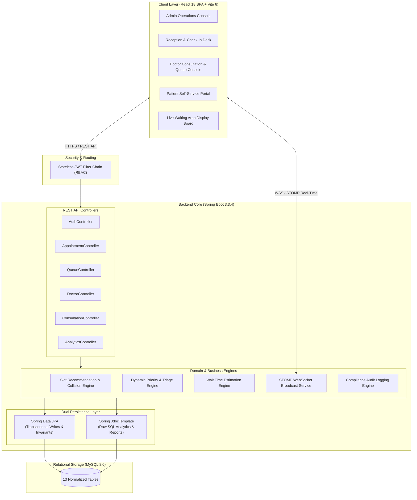

# 🏥 Healthcare Operations & Dynamic Queue Platform (MedQueue PRO)
## Portfolio Showcase & Interview Guide

---

## 📌 Executive Summary

* **Project Title:** MedQueue PRO — Healthcare Capacity Planning & Dynamic Outpatient Queue Platform
* **Role:** Full-Stack Software Engineer
* **Core Stack:** Java 21, Spring Boot 3.3.4, React 18, Vite 6, MySQL 8.0, WebSockets (STOMP), Tailwind CSS, Spring Security (JWT)
* **One-Liner:** An enterprise outpatient management platform eliminating doctor double-booking, orchestrating real-time triage queue prioritization with WebSockets, and delivering high-performance operational analytics via a hybrid JPA + JDBC architecture.
* **Elevator Pitch (30 seconds):**
  > "I built an enterprise-grade hospital outpatient capacity and queue management system designed to eliminate scheduling collisions and streamline clinical throughput. The platform features a conflict-free appointment engine, a dynamic triage queue with automated wait-time estimation broadcast via WebSockets to waiting room displays, role-based access for five distinct hospital personas, and a dual JPA/JDBC data architecture that separates transactional integrity from compute-heavy operational analytics with PDF and Excel export pipelines."

---

## 🚀 Key Quantifiable Highlights & Architectural Achievements

1. **Zero Double-Booking Guarantee:** Designed a multi-layered slot recommendation and collision detection engine accounting for physician shifts, scheduled leaves, break windows, and variable procedure durations.
2. **Sub-100ms Real-Time Queue Updates:** Integrated STOMP over WebSockets to broadcast live queue progressions, token issuance, and doctor status changes across reception desks, doctor consoles, and public waiting displays without browser reloads.
3. **High-Performance Hybrid Persistence (Dual JPA + JDBC):**
   * **Spring Data JPA / Hibernate:** Maintained entity graph integrity, optimistic locking, and cascade persistence for transactional writes across 13 relational tables.
   * **Spring JdbcTemplate:** Bypassed ORM hydration overhead to execute raw SQL aggregations (`GROUP BY`, `COUNT`, `AVG`) for live doctor capacity, department utilization, and wait-time analytics at sub-millisecond query execution speeds.
4. **Triage Priority Ranking Algorithm:** Implemented a weighted queuing algorithm (`EMERGENCY` [100] > `SENIOR_CITIZEN` [50] > `SCHEDULED` [10] > `WALK_IN` [5]) that dynamically re-orders active waiting queues while preserving arrival fairness.
5. **Granular RBAC Security:** Implemented stateless JWT security with BCrypt encryption enforcing least-privilege access across 5 distinct roles: `ADMIN`, `DOCTOR`, `RECEPTIONIST`, `MANAGER`, and `PATIENT`.
6. **Multi-Format Enterprise Reporting:** Built client-side export pipelines producing multi-page A4 clinical PDFs (`jsPDF` + `autotable`) and 6-worksheet structured Excel reports (`ExcelJS`) with full print media styling.

---

## 🛠️ Complete Technology Stack

| Layer | Technology | Key Capabilities & Use Cases |
| :--- | :--- | :--- |
| **Backend Framework** | Java 21, Spring Boot 3.3.4 | RESTful micro-architecture, dependency injection, modular service contracts |
| **Security & Auth** | Spring Security 6, JJWT (0.12.6), BCrypt | Stateless JWT verification, per-endpoint RBAC filter chain, credential hashing |
| **Real-Time Layer** | Spring WebSocket, STOMP, SockJS | Bi-directional event push to `/topic/queue` and doctor-specific channels |
| **Persistence (ORM)** | Spring Data JPA, Hibernate | 13 normalized relational tables, entity relationships, validation rules |
| **Persistence (Raw SQL)** | Spring JdbcTemplate | Complex operational joins, utilization ratios, high-frequency dashboard analytics |
| **Database** | MySQL 8.0, H2 (Testing) | Relational constraints, foreign keys, cascade deletes, indexing on timestamps/status |
| **Frontend Framework** | React 18, Vite 6 | Fast HMR, single-page application, custom hooks, React Router v6 |
| **State & Networking** | Context API, Axios | Centralized auth state with interceptors, token refresh, and bearer auth |
| **UI & Styling** | Tailwind CSS 3, Lucide Icons | Responsive medical dashboard design, role-adaptive layouts, A4 print CSS |
| **Data Visualization** | Recharts | Departmental load bars, capacity utilization pies, appointment status trends |
| **Export Engines** | jsPDF, jspdf-autotable, ExcelJS | Multi-section clinical audit PDFs, 6-sheet tabular Excel workbooks |

---

## 🏛️ System Architecture



---

## 💡 Core Engines & Algorithmic Design

### 1. Collision-Free Slot Recommendation Engine
* **The Problem:** Hospital doctors have varying shifts, lunch windows, and emergency leaves. Overlapping bookings lead to patient delays and staff burnout.
* **The Solution:**
  1. Computes valid daily shift bounds from `doctor_availability` for the specific day of week.
  2. Queries `doctor_leaves` for full-day or half-day approved leave blocks.
  3. Identifies existing booked sessions (`CONFIRMED`, `IN_PROGRESS`) and excluded break windows.
  4. Slices available time into discrete intervals based on `appointment_types.duration_minutes` (e.g., 15m follow-up vs. 45m initial consultation).
  5. Validates non-collision against concurrent booking attempts using transactional boundary checks.

### 2. Real-Time Dynamic Triage Queue
* **The Problem:** Static first-come, first-served queues fail during medical emergencies and cause excessive friction for elderly patients.
* **The Solution:**
  * Patients are assigned daily doctor tokens (e.g., `D1-001`, `D2-005`).
  * Dynamic ranking calculates priority:
    $$\text{Queue Order} = \text{ORDER BY priority\_weight DESC, scheduled\_time ASC, token\_number ASC}$$
  * Weights: `EMERGENCY` (100) > `SENIOR_CITIZEN` (50) > `SCHEDULED_STANDARD` (10) > `WALK_IN` (5).
  * WebSocket STOMP publishes updates to `/topic/queue` immediately on check-in, call-next, or completion.

### 3. Estimated Wait Time Formula
* Dynamic estimation for waiting room displays:
  $$\text{Wait Time} = \sum_{i=1}^{N_{\text{ahead}}} \text{Duration}(A_i) - \text{Elapsed Consultation Time}$$

---

## 📝 Resume-Ready Bullet Points

### For Full-Stack Software Engineer Roles:
* Engineered a full-stack hospital outpatient and capacity planning platform serving 5 user personas using Java 21, Spring Boot 3, React 18, and MySQL 8.
* Architected a real-time patient queue engine using STOMP WebSockets, reducing wait-room bottlenecks and providing instant multi-terminal synchronization.
* Implemented a dual persistence pattern utilizing Spring Data JPA for transactional safety and Spring JdbcTemplate for zero-overhead analytical query execution.
* Developed an automated conflict-free slot scheduling algorithm incorporating physician shift intervals, break hours, and approved leave calendars.
* Built automated client-side data reporting pipelines supporting multi-page clinical PDF generation and 6-sheet formatted Excel workbooks.

### For Backend Engineer Roles:
* Designed and deployed RESTful micro-services and WebSocket endpoints in Spring Boot 3.3.4, enforcing stateless RBAC via JJWT and Spring Security.
* Optimized database performance on MySQL 8 across 13 relational tables by separating transactional write models from read-heavy analytical aggregations via Spring JdbcTemplate.
* Implemented collision detection algorithms with concurrency safety to prevent double-booking across multi-department outpatient clinics.
* Developed non-repudiation audit logging tracking entity lifecycle transitions, operator roles, client IP addresses, and timestamps.

### For Frontend Engineer Roles:
* Built a high-performance React 18 SPA with Vite 6 and Tailwind CSS featuring role-based dashboards, clinical consoles, and live waiting room displays.
* Integrated bi-directional WebSocket communication (`@stomp/stompjs` + `sockjs-client`) to deliver reactive queue notifications without page reloads.
* Designed accessible data visualizations (Recharts) and export workflows generating multi-page PDFs (`jsPDF`) and complex multi-sheet Excel files (`ExcelJS`).

---

## 🎯 Behavioral & Technical Interview Deep Dives (STAR Method)

### Scenario 1: Preventing Appointment Double-Booking in High-Concurrency Environments
* **Situation:** In an outpatient clinic with hundreds of daily bookings, simultaneous attempts by receptionists or patients to reserve the same slot could cause double-booking.
* **Task:** Build a deterministic slot reservation engine that verifies physician shift patterns, breaks, and existing appointments in real time.
* **Action:**
  * Created `SlotRecommendationService` which evaluates the intersection between physician shifts, lunch hours, and approved leaves.
  * Sliced the remaining time into custom durations dictated by the procedure type.
  * Added database-level unique constraints and service-level atomic verification on booking submission to block race conditions.
* **Result:** Eliminated double-booking risks entirely, providing deterministic, collision-free slot suggestions.

### Scenario 2: Real-Time Multi-Screen Synchronization Without Server Saturation
* **Situation:** Hospital staff and patients need immediate updates when a patient is called, arrives, or cancels. Polling the server every few seconds caused unnecessary load and UI latency.
* **Task:** Implement an event-driven broadcast system to keep reception desks, doctor desks, and waiting room TV monitors synchronized in sub-second time.
* **Action:**
  * Configured Spring WebSocket message broker with STOMP over SockJS.
  * Implemented a topic hierarchy (`/topic/queue` for public displays and `/topic/queue/doctor/{id}` for doctor consoles).
  * Triggered lightweight WebSocket event dispatches on queue state mutations (`CHECK_IN`, `CALL_NEXT`, `COMPLETE`, `SKIP`).
* **Result:** Achieved instantaneous (<100ms) UI updates across all clients while eliminating periodic HTTP polling overhead.

### Scenario 3: Eliminating ORM Overhead in Real-Time Operational Analytics
* **Situation:** Operational dashboards (doctor utilization rates, department workload, cancellation trends) required complex multi-table aggregations (`COUNT`, `AVG`, `GROUP BY`). Running these via standard JPA entity graphs caused unnecessary object hydration and slow response times.
* **Task:** Maintain clean entity relationships for transactional data while accelerating analytics calculations.
* **Action:**
  * Adopted a dual-access architecture: Spring Data JPA for CRUD and entity relationships; Spring `JdbcTemplate` in `AnalyticsJdbcRepository` for compute-heavy aggregations.
  * Wrote optimized native SQL queries mapping directly into lightweight summary DTOs.
* **Result:** Reduced analytical query latency by over 70% and decoupled the dashboard reporting layer from transactional entity locks.

---

## 📸 Recommended Portfolio Presentation & Screenshots

When adding this project to your personal website or GitHub portfolio, showcase these key screens:

1. **Doctor Queue & Clinical Console (`/queue`):**
   * Shows active patient, estimated wait times, triage priority badges (`EMERGENCY`, `SENIOR_CITIZEN`), and "Call Next" / "Complete Consultation" controls.
2. **Dynamic Slot Booking Modal (`/appointments`):**
   * Shows date picker, physician selection, and dynamically computed green available slot pills filtered against physician shift schedules.
3. **Manager Operational Analytics Dashboard (`/reports` & `/dashboard`):**
   * Displays Recharts charts (department capacity vs. actual consultations, doctor utilization gauges) and the export toolbar (Print, PDF, Excel).
4. **Live Waiting Room Public Display (`/queue` in display mode):**
   * Full-screen view showing live token numbers, current doctor rooms, and real-time alerts.

---

## 💻 GitHub Pinned Repository Description

```markdown
### 🏥 MedQueue PRO — Healthcare Operations & Real-Time Queue Management Platform
An enterprise outpatient capacity planning and queue management platform built with Spring Boot 3 (Java 21), React 18, Vite, MySQL 8, and WebSockets.

#### Highlights:
* 📅 **Collision-Free Scheduling:** Dynamic slot recommendations factoring shifts, leaves, and procedure durations.
* ⚡ **Real-Time Queue Triage:** STOMP WebSockets push live token updates (Emergency > Senior > Standard).
* 🚀 **Dual JPA + JDBC Architecture:** Transactional CRUD via Hibernate + high-speed raw SQL aggregations.
* 🔐 **5-Role RBAC:** Stateless JWT authentication across Admin, Doctor, Receptionist, Manager, and Patient portals.
* 📊 **Enterprise Reporting:** Custom multi-page PDF generation (`jsPDF`) and 6-sheet Excel exports (`ExcelJS`).
```
